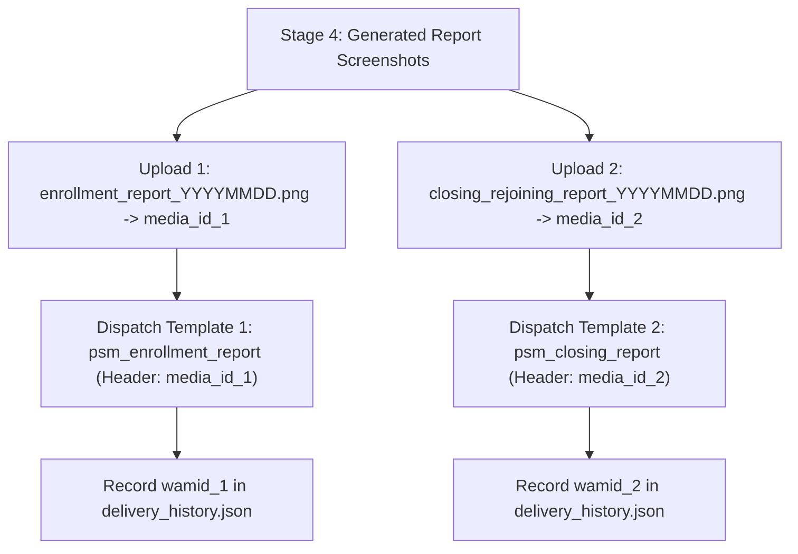

# Pothys Swarna Mahal — WhatsApp Executive Screenshot Delivery Guide

## 1. Overview & Architecture

The Pothys Swarna Mahal Daily Reporting Automation incorporates an optional, highly guarded distribution channel for delivering daily executive report screenshots directly to an authorized recipient via WhatsApp.

```mermaid
graph TD
    A["Verified Report Screenshots Generated"] --> B{"WhatsApp Channel Enabled?"}
    B -->|No (Default: false)| C["Delivery SKIPPED (Zero Outbound Calls)"]
    B -->|Yes| D{"Recipient Configured & Valid?"}
    D -->|Invalid / Missing| E["Delivery HALTED (FAIL-CLOSED)"]
    D -->|Valid| F{"Duplicate-Send Check"}
    F -->|Already Delivered Today| G["Delivery BLOCKED (DUPLICATE)"]
    F -->|New or --force| H{"STRICT_READ_ONLY or dry_run?"}
    H -->|True| I["Simulate Request & Return Mock WAMID (Zero Network Calls)"]
    H -->|False| J["Upload PNG to Meta Media API"]
    J --> K["Dispatch Image Message with Executive Caption"]
    K --> L["Record WAMID in data/delivery/delivery_history.json"]
```

---

## 2. Recommended Integration: Meta WhatsApp Business Cloud API

We implement and recommend the **official Meta WhatsApp Business Platform (Cloud API)**:
- **Direct Infrastructure:** Hosted securely by Meta without third-party middleware or unverified proxy gateways.
- **Enterprise SLA:** High throughput, verified business badge support, and end-to-end encryption.
- **Media Support:** Native high-resolution PNG attachment upload via Meta Graph API `/media` and `/messages` endpoints.

### Meta Cloud API Account & System Prerequisites:
1. **Meta Business Account (WABA):** Created and verified in [Meta Business Manager](https://business.facebook.com/).
2. **Dedicated Phone Number:** A clean mobile or landline number dedicated to Pothys Swarna Mahal reporting (cannot be actively registered on a personal WhatsApp phone without migration).
3. **System User & Permanent Access Token:**
   - Create a System User in Meta Business Manager (`Business Settings` -> `Users` -> `System Users`).
   - Assign the System User to your WhatsApp Business Account with `Full Control`.
   - Generate a permanent System User Access Token with the `whatsapp_business_messaging` permission.
4. **Phone Number ID:** Copied from the WhatsApp API setup dashboard in Meta for Developers.

---

## 3. Dual-Template Delivery Architecture (Meta Policy Compliance)

Meta enforces strict rules for business-initiated conversations outside the 24-hour customer service window:

1. **Free-form media messages (`type: "image"`) are forbidden** unless the recipient texted the business number within the last 24 hours.
2. **Meta templates only allow ONE media attachment per header.** A single template message cannot carry two image headers.

To deliver both the **New Enrollment Report** and the **Scheme Closing & Rejoining Report** in compliance with Meta's API rules, the pipeline implements a **Dual-Template Dispatch Flow**:



### Template 1 Specification: Enrollment Performance
- **Template Name:** `psm_enrollment_report`
- **Category:** `UTILITY`
- **Language:** `en_US` (or `en`)
- **Header:** `MEDIA` -> `IMAGE` (Header image parameter: `media_id_1`)
- **Body:**
  ```text
  📊 *POTHYS SWARNA MAHAL — NEW ENROLLMENT REPORT*
  *Date:* {{1}}
  ━━━━━━━━━━━━━━━━━━━━━━━━━━━━
  Verified cumulative scheme enrollment performance report is attached above.
  🔒 _Confidential — Internal Management Distribution Only_
  ```

### Template 2 Specification: Scheme Closing & Rejoining
- **Template Name:** `psm_closing_report`
- **Category:** `UTILITY`
- **Language:** `en_US` (or `en`)
- **Header:** `MEDIA` -> `IMAGE` (Header image parameter: `media_id_2`)
- **Body:**
  ```text
  📊 *POTHYS SWARNA MAHAL — SCHEME CLOSING & REJOINING REPORT*
  *Date:* {{1}}
  ━━━━━━━━━━━━━━━━━━━━━━━━━━━━
  Verified showroom closing and rejoining reconciliation report is attached above.
  🔒 _Confidential — Internal Management Distribution Only_
  ```

---

## 4. Implemented Code vs. External Meta Account Actions

To maintain complete clarity on system readiness:

### What Is Fully Implemented in This Codebase:
- ✅ Dual-template message request construction with image headers and body parameters.
- ✅ Free-form session-message delivery path for within-24h active windows (`WHATSAPP_DELIVERY_MODE=session`).
- ✅ Dynamic resolution of both screenshot paths from `data/screenshots/` by target date.
- ✅ Dry-run simulation producing realistic simulated message IDs (`wamid_sim_tmpl1_...` and `wamid_sim_tmpl2_...`) with zero outbound requests.
- ✅ Persistent duplicate-send protection in `data/delivery/delivery_history.json` with `--force` override.
- ✅ Timeout handling (30s), HTTP error parsing, phone masking (`+9198******56`), and secret token redaction.
- ✅ Fail-closed behavior: fails if templates are missing, recipient is invalid, or credentials are absent in live mode.

### What Must Be Completed in Meta Business Suite:
- ⏳ Submitting `psm_enrollment_report` and `psm_closing_report` in WhatsApp Manager and obtaining approval.
- ⏳ Registering and verifying the dedicated business phone number.
- ⏳ Generating a permanent System User Token with `whatsapp_business_messaging`.
- ⏳ Configuring `.env` with live credentials and verified recipient phone number.


---

## 4. Configuration & Recipient Setup

The recipient and API credentials are configured via environment variables in `.env` or in `config/app.yaml`:

```bash
# ==============================================================================
# WhatsApp Business Cloud API Configuration
# ==============================================================================
# Master Enable Toggle (STRICTLY FALSE by default)
WHATSAPP_ENABLED=false

# Dry Run Simulation (Set to true for safe local testing)
WHATSAPP_DRY_RUN=true

# Authorized Executive Recipient (E.164 format or 10-digit Indian mobile)
WHATSAPP_RECIPIENT=+919840123456

# Meta Cloud API Credentials (Obtained from Meta Business Manager)
WHATSAPP_PHONE_NUMBER_ID=109876543210987
WHATSAPP_API_TOKEN=EAABwzLxyz...

# Optional Template Name (if sending template messages outside 24h window)
WHATSAPP_TEMPLATE_NAME=psm_daily_executive_report
WHATSAPP_TEMPLATE_LANGUAGE=en_US
```

### Recipient Number Validation Rules
The adapter automatically normalizes and validates recipient numbers:
- `9840123456` -> `+919840123456`
- `09840123456` -> `+919840123456`
- `919840123456` -> `+919840123456`
- `+919840123456` -> `+919840123456`
- Invalid formats (non-numeric, bad start digit, wrong length) fail closed immediately before any request is generated.

---

## 5. Report Attachments Discovered and Delivered

The delivery module dynamically discovers and delivers the two verified daily screenshots generated in Stage 4:
1. `enrollment_report_{YYYYMMDD}.png` (e.g., `data/screenshots/enrollment_report_20261020.png`)
2. `closing_rejoining_report_{YYYYMMDD}.png` (e.g., `data/screenshots/closing_rejoining_report_20261020.png`)

### Attachment Guardrails:
- Maximum attachment size: 5 MB per file (Meta Cloud API limit).
- Supported extensions: `.png`, `.jpg`, `.jpeg`, `.pdf`.
- File non-empty validation: 0-byte or corrupted files are rejected.
- Missing files trigger a fail-closed status: delivery is halted if either screenshot is missing.

---

## 6. Safety, Security & Redaction

- **Read-Only Lock:** If `STRICT_READ_ONLY=true` is set in `.env`, the adapter **unconditionally forces dry-run simulation mode**, regardless of the `WHATSAPP_DRY_RUN` setting.
- **Credential Protection:** Tokens and credentials are never printed to console or logs.
- **Recipient Masking:** Phone numbers are masked in all log entries: `+9198******56`.
- **Error Sanitization:** If Meta returns an API error, authorization tokens are stripped from the message before logging.

---

## 7. Idempotency & Duplicate-Send Protection

To avoid spamming executive management with duplicate daily messages during pipeline retries, deliveries are recorded in:
`data/delivery/delivery_history.json`

- **Duplicate Check:** If a report for date `YYYY-MM-DD` has already been delivered to `recipient` with status `SENT`, further attempts return `DUPLICATE` and abort send.
- **Partial Failure & Recovery Safety:**
  - Because dual-template delivery requires two separate Meta API calls, network disruptions or API timeouts could occur after Template 1 succeeds but before Template 2 completes.
  - When Template 1 (`psm_enrollment_report`) dispatches successfully, its message ID and attachment filename (`enrollment_report_YYYYMMDD.png`) are immediately recorded with status `PARTIAL`.
  - On automated or manual retry, the adapter detects the partial delivery record, **skips re-sending Template 1**, and dispatches only Template 2 (`psm_closing_report`).
  - Once Template 2 succeeds, the ledger record is updated to status `SENT` with both message IDs (`wamid_1,wamid_2`). This completely eliminates duplicate sends during failure recovery.
- **Manual Override:** To intentionally re-send all report templates from scratch, pass `--force`:
  ```powershell
  python -m app send-whatsapp --dry-run --report-date 2026-10-20 --recipient +919840123456 --force
  ```

---

## 8. Operational Costs (Meta WhatsApp Pricing)

- **Utility Conversation Pricing (India):** Meta charges per 24-hour conversation window.
  - Rate for Utility messages in India: **~₹0.11 to ₹0.15 per conversation window**.
  - All subsequent messages sent within the same 24-hour window are included at no extra cost.
- **Estimated Monthly Cost:**
  - 1 executive recipient × 30 days = 30 conversation windows.
  - Total monthly expenditure: **~₹3.30 to ₹4.50 INR per month**.

---

## 9. Verification & Manual Testing Procedure

### Step 1: Dry-Run CLI Test (Recommended)
Verify recipient validation, file resolution, request construction, and simulated dispatch:
```powershell
python -m app send-whatsapp --dry-run --report-date 2026-10-20 --recipient 9840123456
```
Expected output:
```text
======================================================================
POTHYS SWARNA MAHAL WHATSAPP REPORT DELIVERY
======================================================================
Report Date:   20/10/2026 (2026-10-20)
Mode:          DRY RUN (Simulated)

----------------------------------------------------------------------
DELIVERY RESULT
----------------------------------------------------------------------
Status:           SENT
Recipient:        +919******56
Message ID:       wamid_sim_...
Attachments Sent: 2

SUCCESS: WhatsApp executive report delivery completed successfully.
```

### Step 2: Test Duplicate-Send Prevention
Run the exact same command a second time without `--force`:
```text
WARNING: Duplicate delivery blocked: report 2026-10-20 already delivered to recipient. Use --force to override.
```

### Step 3: Test Forced Re-send
Run with `--force`:
```powershell
python -m app send-whatsapp --dry-run --report-date 2026-10-20 --recipient 9840123456 --force
```

---

## 10. Production Authorization Checklist

Before enabling live messaging (`whatsapp.enabled: true` and `whatsapp.dry_run: false`), ensure:

| # | Item | Status | Verification Method |
|---|------|:------:|---------------------|
| 1 | Full unit test suite passing (218+ tests) | ✅ Complete | `python -m pytest` |
| 2 | Screenshot resolution verified for current dates | ✅ Complete | Inspected `data/screenshots/` |
| 3 | Dry-run simulated delivery tested | ✅ Complete | Executed `send-whatsapp --dry-run` |
| 4 | Duplicate delivery protection verified | ✅ Complete | Verified duplicate rejection |
| 5 | Meta Business Manager account created and verified | ⏳ Pending Auth | Meta Business Suite |
| 6 | Dedicated business phone number registered | ⏳ Pending Auth | WhatsApp Manager |
| 7 | Permanent System User access token generated | ⏳ Pending Auth | System Users console |
| 8 | Transactional Utility template approved by Meta | ⏳ Pending Auth | WhatsApp Message Templates |
| 9 | Authorized recipient phone number confirmed by GM | ⏳ Pending Auth | Management confirmation |
| 10| Written approval for live outbound messaging | ⏳ Pending Auth | Formal sign-off |
