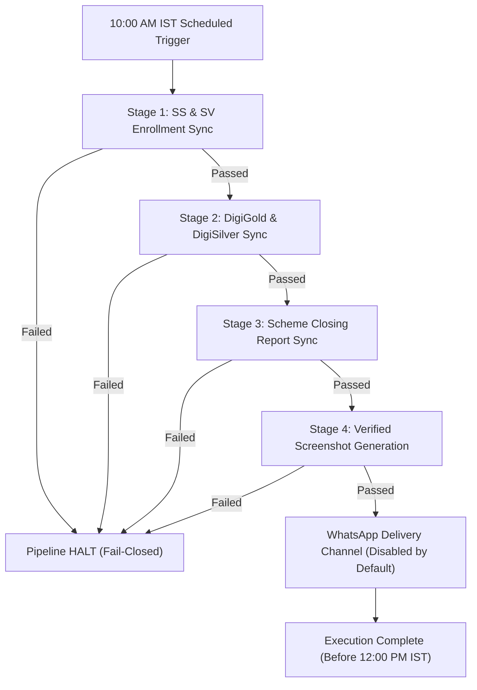

# Windows Task Scheduler Setup & Operations Guide
## Pothys Swarna Mahal — Daily Reporting Automation Pipeline

---

## 1. Executive Overview & Security Mandate

The **Pothys Swarna Mahal Daily Reporting Automation** system executes a unified 4-stage pipeline every morning to synchronize previous-day sales, enrollments, digi-assets, closures, and executive dashboard tables across Google Sheets.

> [!CAUTION]
> ### Strict Read-Only Mode Mandate
> By default, the system operates under **STRICT READ-ONLY MODE** (`STRICT_READ_ONLY=true` in `.env`). In this mode:
> - All write, update, clear, and append calls to Google Sheets API are **permanently blocked at client and CLI layers**.
> - The application operates exclusively with read-only OAuth scopes (`https://www.googleapis.com/auth/spreadsheets.readonly`).
> - The automated scheduler executes with `-Mode dry-run` to verify pipeline integrity, source availability, and schema consistency without modifying live data.
> - **Production write enablement requires separate, explicit management authorization.**

---

## 2. Automated Pipeline Stages & Business Window

The daily executive reporting pipeline operates within a mandatory business window: **every day between 10:00 AM and 12:00 PM (noon) India Standard Time (Asia/Kolkata)**.



1. **Stage 1 — SS & SV Enrollment Data:**
   - Authenticates to Innervex (`http://192.168.5.213:4499`).
   - Downloads previous-day raw enrollment records (21 columns).
   - Cleans and maps to canonical 11 columns; derives `LOCATION`, `CODE_NAME`, `LOCATION_2`.
   - Reconciles against target Google Sheet (`SS - Oct` / `SV - Oct`).
   - Appends only verified new records; preserves formula columns H & N.

2. **Stage 2 — DigiGold & DigiSilver Synchronization:**
   - Reads daily achieved counts from source `OCT Pivot` tab.
   - Updates destination `Consolidate Report - Oct` (columns `I20:I29` for DigiGold and `J20:J29` for DigiSilver).
   - Updates title date header (cell `E3`) and dynamic average divisor formulas in column L (`L20:L30`).
   - Verifies all written values post-update.

3. **Stage 3 — Scheme Closing Report Synchronization:**
   - Queries Innervex Scheme Closing Report for 32 active showrooms and 6 required schemes.
   - Excludes DigiGold and DigiSilver schemes.
   - Cleans to canonical 7 columns (A:G) and appends to destination `October - 2026`.
   - Extends VLOOKUP formulas in columns H and I.
   - Reconciles Summary Table `CLOSED` counts against Pivot Table `COUNTA OF SCHEMENAME` across all 9 reporting showrooms.

4. **Stage 4 — Verified Screenshot Generation:**
   - Validates that both destination sheets reflect the expected target report date (halts if stale).
   - Exports high-resolution PDF canvases via Google Drive API.
   - Renders at 200 DPI using PyMuPDF and crops white borders.
   - Saves presentation-ready PNGs to `data/screenshots/`.

5. **Delivery Channel — WhatsApp:**
   - Evaluates `whatsapp.enabled` flag (configured as `false` by default).
   - In dry-run mode, logs simulated receipt without external network calls.
   - When enabled in future authorized production, dispatches two pre-approved Meta utility templates (`psm_enrollment_report` and `psm_closing_report`).

---

## 3. Business Window Analysis, Runtime Benchmarks & Retry Strategy

### Why 10:00 AM to 12:00 PM IST?
1. **ERP Data Completeness:** Branch closure reconciliations, late-night POS settlements, and bank syncs from day T-1 are consolidated in Innervex by 09:30 AM IST. An earlier trigger (e.g., 06:00 AM) risks reading incomplete batches.
2. **Executive Delivery SLA:** Executive management requires verified morning performance cards delivered to WhatsApp by 12:00 PM (noon).

### Expected Runtime Benchmarks (Code & Log Analysis)
Based on execution logs across thousands of real showroom rows:
- **Innervex Authentication & Report Downloads:** ~15 to 35 seconds (for ~13,000+ raw records over LAN/VPN).
- **Data Cleaning, Normalization & Derivation:** ~2 to 5 seconds.
- **Google Sheets Live Read & Reconciliation:** ~15 to 30 seconds.
- **Google Sheets Updates (When Authorized):** ~10 to 20 seconds.
- **PDF Export & PyMuPDF 200 DPI Rendering (2 Canvases):** ~10 to 20 seconds.
- **WhatsApp Template Dispatch (When Authorized):** ~5 to 10 seconds.
- **Total Nominal Runtime:** **1 to 2 minutes** (60–120 seconds).
- **Worst-Case Runtime (with network jitter & Google API backoff retries):** **3 to 8 minutes**.

> [!IMPORTANT]
> **No Unqualified Guarantees:** While nominal execution requires under 2 minutes, completing by 12:00 PM IST strictly depends on:
> 1. Host machine network route to Innervex LAN (`192.168.5.213`).
> 2. Innervex server availability and non-empty responses.
> 3. Google API quota health.
> If any critical validation fails, the pipeline halts immediately to prevent corrupting reports.

### Single Trigger vs. Multiple Retry Checks: Which Is Safer?
- **Single Trigger (e.g. only once at 10:00 AM):** Highly fragile. A single transient 30-second network hiccup or VPN reconnect would cause the entire daily run to fail without recovery.
- **Scheduled 10:00 AM Trigger with Configured Retries (Recommended):**
  - Trigger initially at **10:00 AM IST**.
  - Configure Task Scheduler to restart on failure every **15 minutes**, up to **3 times** (attempts at 10:00 AM, 10:15 AM, 10:30 AM, 10:45 AM).
  - This provides a generous **2-hour operational window** to absorb transient glitches well before the 12:00 PM deadline.

### Why Retries Cannot Create Duplicate Writes or Duplicate WhatsApp Messages:
1. **Idempotent Primary Keys (`MSNO`):** Stages 1 and 3 check existing row identifiers in the Google Sheet. Existing `MSNO` keys are automatically deduplicated and ignored on retry.
2. **Pre-Check Verification:** Stage 2 verifies cell values before updating and performs post-write checks.
3. **WhatsApp Delivery History Ledger:**
   - [`DeliveryHistory`](file:///c:/Users/Pothys/.gemini/antigravity-ide/scratch/pothys-reporting-automation/app/delivery/whatsapp.py#L197) in `data/delivery/delivery_history.json` records every successful dispatch for `(report_date, recipient)`. Once marked `SENT`, repeat runs return `DUPLICATE` and abort with zero network calls.
   - **Partial Failure Protection:** If Template 1 succeeded but Template 2 failed, the retry inspects the ledger, **skips re-sending Template 1**, and only dispatches Template 2.
4. **Clean Exit:** Once the pipeline succeeds (exit code 0), Task Scheduler does not trigger further retries for that day.

---

## 4. Safe Scheduled Audit vs. Authorized Production Workflow

| Parameter | Safe Scheduled Audit (Current Configuration) | Authorized Production Workflow (Future State) |
|---|---|---|
| **Execution Mode** | `-Mode dry-run` (or `-Mode mock`) | `-Mode live` (requires script policy change) |
| **STRICT_READ_ONLY** | `true` in `.env` (enforced at API client layer) | `false` in `.env` (requires AGM authorization) |
| **Google Sheets Access** | Read-Only scope (`spreadsheets.readonly`) | Read/Write scope (`spreadsheets`) |
| **Service Account Role** | Viewer permission sufficient | Editor permission required on all 3 target workbooks |
| **WhatsApp Master Flag** | `whatsapp.enabled: false` | `whatsapp.enabled: true` |
| **WhatsApp Mode** | `dry_run: true` (zero network calls) | `dry_run: false` (dispatches to Meta Cloud API) |
| **External Writes** | **Zero Google Sheets writes** | Appends daily rows & updates title date |
| **Executive Delivery** | Simulated receipt in local ledger | Dual pre-approved templates sent to executive |

---

## 5. Task Scheduler Configuration

### Option A: Automated PowerShell Setup (Recommended)

Open **PowerShell as Administrator** and execute:

```powershell
# 1. Define Paths and Variables
$TaskName = "Pothys-PSM-Daily-Reporting-Audit"
$ProjectDir = "C:\Users\Pothys\.gemini\antigravity-ide\scratch\pothys-reporting-automation"
$ScriptPath = "$ProjectDir\scripts\run_daily_report.ps1"
$Time = "10:00AM"

# 2. Define Action (Executes runner script in safe dry-run mode)
$Action = New-ScheduledTaskAction `
    -Execute "powershell.exe" `
    -Argument "-ExecutionPolicy Bypass -WindowStyle Hidden -File `"$ScriptPath`" -Mode dry-run" `
    -WorkingDirectory $ProjectDir

# 3. Define Trigger (Daily at 10:00 AM IST)
$Trigger = New-ScheduledTaskTrigger -Daily -At $Time

# 4. Define Settings (15-min retry interval up to 3 times within 10 AM - 12 PM window)
$Settings = New-ScheduledTaskSettingsSet `
    -AllowStartIfOnBatteries `
    -DontStopIfGoingOnBatteries `
    -StartWhenAvailable `
    -RestartCount 3 `
    -RestartInterval (New-TimeSpan -Minutes 15) `
    -ExecutionTimeLimit (New-TimeSpan -Hours 1)

# 5. Register Task (SAFE AUDIT MODE ONLY - ZERO PRODUCTION WRITES)
Register-ScheduledTask `
    -TaskName $TaskName `
    -Action $Action `
    -Trigger $Trigger `
    -Settings $Settings `
    -Description "Pothys Swarna Mahal daily reporting automation pipeline (Safe Dry-Run Audit Mode)."

Write-Host "Task '$TaskName' registered successfully." -ForegroundColor Green
```

---

### Option B: Manual Setup via Windows Task Scheduler GUI (`taskschd.msc`)

1. Press `Win + R`, type `taskschd.msc`, and press **Enter**.
2. In the right pane, click **Create Task...** (do not click *Create Basic Task*).
3. **General Tab:**
   - **Name:** `Pothys-PSM-Daily-Reporting-Audit`
   - **Description:** `Daily morning reporting audit for Pothys Swarna Mahal (10:00 AM - 12:00 PM IST Window).`
   - **Security Options:** Select *Run whether user is logged on or not*.
   - Check *Run with highest privileges*.
   - Configure for: *Windows 10 / Windows Server 2019/2022*.
4. **Triggers Tab:**
   - Click **New...**
   - Begin the task: *On a schedule*
   - Settings: *Daily*, recur every `1` days.
   - Start: `10:00:00 AM`.
   - Enabled: **Checked**.
5. **Actions Tab:**
   - Click **New...**
   - Action: *Start a program*.
   - **Program/script:** `powershell.exe`
   - **Add arguments:**
     ```text
     -ExecutionPolicy Bypass -WindowStyle Hidden -File "C:\Users\Pothys\.gemini\antigravity-ide\scratch\pothys-reporting-automation\scripts\run_daily_report.ps1" -Mode dry-run
     ```
   - **Start in:**
     ```text
     C:\Users\Pothys\.gemini\antigravity-ide\scratch\pothys-reporting-automation
     ```
6. **Conditions Tab:**
   - Uncheck *Stop if the computer switches to battery power*.
   - Check *Wake the computer to run this task* (if applicable).
   - Check *Start only if the following network connection is available* -> Any connection.
7. **Settings Tab:**
   - Check *Allow task to be run on demand*.
   - Check *Run task as soon as possible after a scheduled start is missed*.
   - If the task fails, restart every: `15 minutes`, attempt up to `3` times.
   - Stop the task if it runs longer than: `1 hour`.
8. Click **OK** to save the task.

---

## 6. Verification and Operational Testing

To verify the scheduled task on demand without waiting for 10:00 AM:

```powershell
# Run the scheduled task immediately
Start-ScheduledTask -TaskName "Pothys-PSM-Daily-Reporting-Audit"

# Check the task state
Get-ScheduledTask -TaskName "Pothys-PSM-Daily-Reporting-Audit" | Select-Object TaskName, State
```

Inspect execution output in the logs directory:
- Runner log: `logs/scheduler_YYYYMMDD_HHMMSS.log`
- Application pipeline log: `logs/run_RUN-*.log`

---

## 7. Production Authorization Checklist

Before modifying `-Mode live` or disabling `STRICT_READ_ONLY`, the following requirements **must** be met:

| # | Requirement | Status | Verification Method |
|---|-------------|--------|---------------------|
| 1 | All 224 test cases passing | ✅ Complete | `python -m pytest` |
| 2 | CPT Closing showroom reconciliation verified (370 vs 370) | ✅ Complete | Scoped table header parsing |
| 3 | DigiGold / DigiSilver exclusion confirmed | ✅ Complete | Zero digi records in closing sheet |
| 4 | Offline mock screenshot validation | ✅ Complete | Verified dimensions & date stamp |
| 5 | WhatsApp delivery adapter tested with dual templates | ✅ Complete | 29 delivery unit tests passing |
| 6 | Service Account assigned Editor permissions on target workbooks | ⏳ Pending Auth | Google Drive share dialog |
| 7 | Written authorization from AGM / Executive Leadership | ⏳ Pending Auth | Executive sign-off document |
| 8 | Formal change window scheduled | ⏳ Pending Auth | IT change calendar |
| 9 | Backup snapshots taken of live Google Sheets workbooks | ⏳ Pending Auth | Google Drive copy/export |
| 10| `STRICT_READ_ONLY` toggle set to `false` in `.env` | ⏳ Pending Auth | Environment configuration update |
